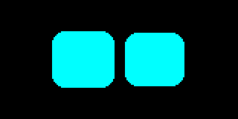
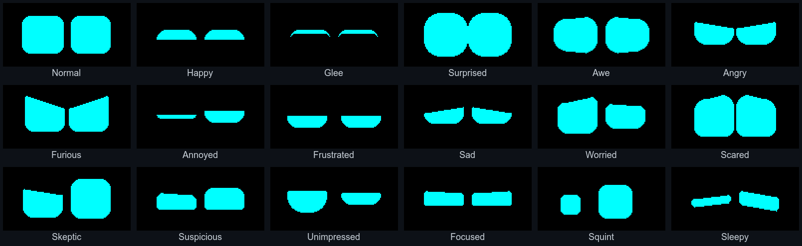
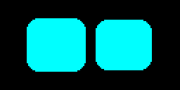
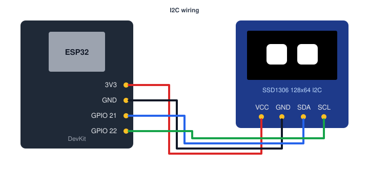
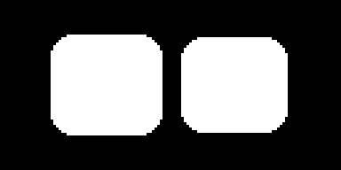
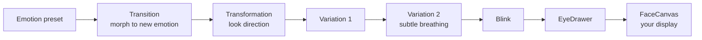

# ESP32_Faces

**Expressive animated robot eyes for ESP32, ESP8266 and Arduino.**
18 emotions, smooth transitions, blinking and looking around, on OLED and colour TFT displays.

<p align="center">
  
</p>

The eyes are not bitmaps: every frame is drawn from a handful of parameters (size, slope,
corner radius...), so expressions morph smoothly into each other, scale to any screen
size and take almost no flash memory.

## Features

- **18 emotions** ready to use: normal, happy, glee, sad, angry, furious, surprised, sleepy, suspicious...
- **Smooth transitions** between any two emotions, plus subtle "breathing" variations
- **Automatic blinking** and **looking around**, or full manual control
- **Random weighted behaviour**: tell it how happy or grumpy it should be and it does the rest
- **Any display**: U8g2 and Adafruit OLEDs, TFT_eSPI, M5Stack / M5StickC, M5GFX, LovyanGFX, Adafruit TFTs, or your own in 4 functions
- **Any size and colour**: expressions scale automatically with the eye size
- **PC simulator** to preview and design expressions without hardware

## Emotions

<p align="center">
  
</p>

<details>
<summary><b>See every emotion animated</b></summary>

|   |   |   |
|:-:|:-:|:-:|
|  |  |  |
| `Normal` | `Happy` | `Glee` |
|  |  |  |
| `Surprised` | `Awe` | `Angry` |
|  |  |  |
| `Furious` | `Annoyed` | `Frustrated` |
|  |  |  |
| `Sad` | `Worried` | `Scared` |
|  |  |  |
| `Skeptic` | `Suspicious` | `Unimpressed` |
|  |  |  |
| `Focused` | `Squint` | `Sleepy` |

</details>

## Quick start (ESP32 + 0.96" OLED)

The cheapest way to try it: an ESP32 (or ESP8266) and a 128x64 SSD1306 I2C OLED, four wires.

<p align="center">
  
</p>

| OLED | ESP32   | ESP8266 (NodeMCU / Wemos D1) |
|------|---------|------------------------------|
| VCC  | 3V3     | 3V3                          |
| GND  | GND     | GND                          |
| SDA  | GPIO 21 | D2 (GPIO 4)                  |
| SCL  | GPIO 22 | D1 (GPIO 5)                  |

1. Install the library (see [Installation](#installation)) and **U8g2** from the Library Manager.
2. Open **File → Examples → ESP32_Faces → OLED_U8g2** and upload it.

That is the whole sketch:

```cpp
#include <U8g2lib.h>
#include <ESP32_Faces.h>
#include <canvas/U8g2Canvas.h>

U8G2_SSD1306_128X64_NONAME_F_HW_I2C u8g2(U8G2_R0, U8X8_PIN_NONE);
U8g2Canvas<U8G2> canvas(u8g2);

Face face(canvas, 128, 64, 40);   // canvas, screen width, screen height, eye size

void setup() {
  u8g2.begin();
}

void loop() {
  face.Update();   // blinks, looks around and changes emotion on its own
}
```

<p align="center">
  
</p>

## Installation

**Arduino IDE**

1. Download this repository as ZIP (**Code → Download ZIP**).
2. In the Arduino IDE: **Sketch → Include Library → Add .ZIP Library...** and select the file.
3. Install the library for your display from the Library Manager (U8g2, Adafruit SSD1306, TFT_eSPI, M5StickC...).

**PlatformIO**

```ini
lib_deps =
    https://github.com/luisllamasbinaburo/ESP32_Faces.git
    olikraus/U8g2
```

## Supported displays

The library draws through a tiny interface (`FaceCanvas`). Pick the adapter for your display library:

| Display library | Adapter | Typical hardware |
|---|---|---|
| [U8g2](https://github.com/olikraus/u8g2) | `canvas/U8g2Canvas.h` → `U8g2Canvas<U8G2>` | SSD1306, SH1106, SSD1309 OLEDs |
| [Adafruit SSD1306](https://github.com/adafruit/Adafruit_SSD1306) / SH110X | `canvas/AdafruitGFXCanvas.h` → `AdafruitMonoCanvas<...>` | SSD1306, SH1106, SH1107 OLEDs |
| Adafruit ST7735 / ST7789 / ILI9341 | `canvas/AdafruitGFXCanvas.h` → `AdafruitTFTCanvas<...>` | Colour TFTs |
| [TFT_eSPI](https://github.com/Bodmer/TFT_eSPI) | `canvas/TFTSpriteCanvas.h` → `TFTSpriteCanvas<TFT_eSprite>` | T-Display, CYD, any TFT_eSPI screen |
| M5StickC / M5Stack | `canvas/TFTSpriteCanvas.h` → `TFTSpriteCanvas<TFT_eSprite>` | M5StickC, M5StickC Plus, M5Stack |
| [M5GFX](https://github.com/m5stack/M5GFX) / [LovyanGFX](https://github.com/lovyan03/LovyanGFX) | `canvas/TFTSpriteCanvas.h` → `TFTSpriteCanvas<M5Canvas>` / `<LGFX_Sprite>` | M5 devices, Lovyan-supported screens |

**Boards**: designed for ESP32 and ESP8266, and it runs on any Arduino-compatible board with enough RAM for
the display's frame buffer (the Arduino Mega works; an Arduino Uno does not have enough RAM for a 128x64 OLED).

### Colour TFT (TFT_eSPI)

```cpp
#include <TFT_eSPI.h>
#include <ESP32_Faces.h>
#include <canvas/TFTSpriteCanvas.h>

TFT_eSPI tft;
TFT_eSprite sprite(&tft);
TFTSpriteCanvas<TFT_eSprite> canvas(sprite);
Face face(canvas, 240, 135, 70);   // bigger eyes, presets scale automatically

void setup() {
  tft.init();
  tft.setRotation(1);
  sprite.setColorDepth(8);
  sprite.createSprite(240, 135);
  face.SetColor(TFT_CYAN, TFT_BLACK);
}

void loop() {
  face.Update();
}
```

### Your own display

Implement four methods and you are done:

```cpp
class MyCanvas : public FaceCanvas {
public:
  void clear(uint16_t color) override { /* fill the whole buffer */ }
  void fillRect(int16_t x, int16_t y, int16_t w, int16_t h, uint16_t color) override { /* ... */ }
  void fillTriangle(int16_t x0, int16_t y0, int16_t x1, int16_t y1,
                    int16_t x2, int16_t y2, uint16_t color) override { /* ... */ }
  void flush() override { /* send the buffer to the screen */ }
};
```

Colours are RGB565. On monochrome displays any non-zero colour means "pixel on".

## Usage

### Show an emotion

```cpp
face.RandomBehavior = false;            // stop changing emotions on its own
face.GoToEmotion(eEmotions::Happy);     // smooth transition to happy
```

Or call the expression directly: `face.Expression.GoTo_Angry();`

`GetEmotionName(eEmotions::Happy)` returns `"Happy"`, handy for serial menus or debugging.

### Random behaviour

Give each emotion a weight. Every few seconds the face picks one at random, proportionally to its weight
(roulette wheel selection). Emotions with weight 0 are never picked.

```cpp
face.Behavior.Clear();                                // all weights to 0
face.Behavior.SetEmotion(eEmotions::Normal, 2.0);     // 2/3 of the time
face.Behavior.SetEmotion(eEmotions::Happy, 1.0);      // 1/3 of the time
face.Behavior.Timer.SetIntervalMillis(3000);          // pick again every 3 s
face.RandomBehavior = true;
```

Weights are a great way to connect the face to the real world: map a sensor, a battery level or
how long since the last interaction to the weight of `Sleepy`, `Angry` or `Happy`.

### Look around

```cpp
face.RandomLook = false;     // stop looking around on its own
face.LookAt(-1.0, 0.5);      // x: -1 (left) ... 1 (right), y: -1 (down) ... 1 (up)
face.LookLeft();             // also LookRight, LookTop, LookBottom, LookFront
face.Look.Timer.SetIntervalMillis(2000);   // how often it looks somewhere else when random
```

### Blink

```cpp
face.DoBlink();
face.RandomBlink = true;                       // on by default
face.Blink.Timer.SetIntervalMillis(4000);     // blink every 4 s
```

### Colours and size

```cpp
Face face(canvas, 240, 135, 70);              // eye size 70 px: everything scales from the 40 px design
face.SetColor(FACE_ORANGE, FACE_BLACK);       // eye colour, background colour (RGB565)
face.EyeInterDistance = 6;                    // gap between the eyes
```

### API summary

| Member | Description |
|---|---|
| `Face(canvas, width, height, eyeSize = 40)` | Creates the face |
| `Update()` | Call it from `loop()` as often as possible |
| `GoToEmotion(emotion)` | Transition to an emotion |
| `RandomBehavior`, `RandomLook`, `RandomBlink` | Enable/disable each automatic behaviour |
| `Behavior.SetEmotion(emotion, weight)` / `Clear()` | Weights for random emotions |
| `Behavior.Timer`, `Look.Timer`, `Blink.Timer` | `SetIntervalMillis(ms)` of each automatic behaviour |
| `LookAt(x, y)`, `LookLeft()`, `LookRight()`, `LookTop()`, `LookBottom()`, `LookFront()` | Where the eyes look |
| `DoBlink()` | Blink now |
| `SetColor(eye, background)` | Colours (RGB565) |
| `Wait(ms)` | Keep animating for a while (blocking), useful in scripted sequences |

## Examples

| Example | What it shows |
|---|---|
| [OLED_U8g2](examples/OLED_U8g2/OLED_U8g2.ino) | The basics on an SSD1306 OLED with U8g2 |
| [OLED_Adafruit_SSD1306](examples/OLED_Adafruit_SSD1306/OLED_Adafruit_SSD1306.ino) | Same, with the Adafruit libraries |
| [TFT_eSPI_Sprite](examples/TFT_eSPI_Sprite/TFT_eSPI_Sprite.ino) | Colour TFT, bigger eyes, all emotions |
| [M5StickC_Accelerometer](examples/M5StickC_Accelerometer/M5StickC_Accelerometer.ino) | The face reacts to how you hold an M5StickC |
| [Joystick_Control](examples/Joystick_Control/Joystick_Control.ino) | Look around with a joystick, set the mood with potentiometers |
| [Serial_Control](examples/Serial_Control/Serial_Control.ino) | Type `happy`, `left`, `blink`... in the Serial Monitor |

## How it works

Each eye is described by an `EyeConfig`: offset, width, height, top and bottom slope, corner radius
and inverse ("cheek") radius. Each emotion is just a preset of these values (`EyePresets.h`), so new
expressions are easy to create.

Every frame, each eye's config goes through a chain of small operators before being drawn:



On top of that, three assistants drive the face automatically: `FaceBehavior` (random weighted emotions),
`LookAssistant` (random looks) and `BlinkAssistant` (blinking).

## Simulator

The [tools/simulator](tools/simulator) folder builds the library for your PC (CMake, any C++20 compiler)
and records the face to GIF. All the images in this README were generated with it. It is the fastest
way to tweak a preset or design a new emotion.

```bash
cmake -S tools/simulator -B tools/simulator/build
cmake --build tools/simulator/build --config Release
```

## Upgrading from version 1

Version 2 is not tied to the M5StickC any more. If you used version 1:

- Include `<ESP32_Faces.h>` and create a canvas adapter, then pass it to `Face` instead of the `TFT_eSprite`.
- `Face(buffer, height, width, eye)` with swapped dimensions is now `Face(canvas, width, height, eye)`,
  drawn in landscape. On the M5StickC call `M5.Lcd.setRotation(1)` and create a 160x80 sprite
  (see the [M5StickC example](examples/M5StickC_Accelerometer/M5StickC_Accelerometer.ino)).
- `LookAt(x, y)`: positive `x` now looks to the right.
- `Fustrated` was renamed `Frustrated` (the old name still compiles).

## Projects based on ESP32_Faces

- [esp32-eyes](https://github.com/playfultechnology/esp32-eyes) by Playful Technology, an OLED port of this library.

Built something with it? Open an issue or a pull request and it will be added here.

## Author

Made by **Luis Llamas**. Find more tutorials about Arduino, ESP32 and electronics at
[www.luisllamas.es](https://www.luisllamas.es).

## License

See [LICENSE](LICENSE).
